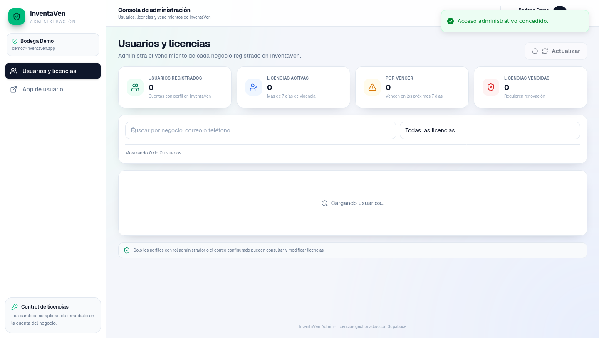

# InventaVen Admin

InventaVen Admin es la consola de administracion de licencias y usuarios de InventaVen.




## Funcionalidades

- Consulta de usuarios registrados.
- Control de licencias activas, por vencer y vencidas.
- Extension de licencias, fijacion de fecha y revocacion.

## Stack

- Next.js, React, Tailwind CSS.
- Supabase para datos de usuarios y licencias.

## Puesta en marcha

```bash
npm install
npm run dev
```

## Variables de entorno

- `NEXT_PUBLIC_SUPABASE_URL`
- `NEXT_PUBLIC_SUPABASE_ANON_KEY`
- `SUPABASE_SERVICE_ROLE_KEY`
- `NEXT_PUBLIC_APP_URL`
- `ADMIN_EMAIL`
- `CAPTCHA_SECRET`

## Seguridad

- Acceso restringido al rol de administrador.
- La llave de servicio no debe exponerse en el cliente.
